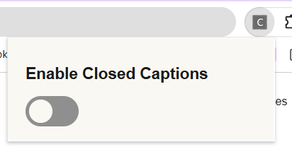
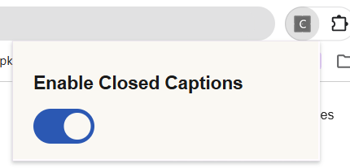

# Closed Captioning Extension

A Chrome extension that adds real-time closed captions to videos playing in your browser, with a one-click on/off toggle. Built with accessibility as the core goal.

> **Status:** Phase 1 complete (popup toggle with persisted state). Audio capture and AI captioning are in progress.




## What it will do

1. Capture the audio of the current tab (YouTube and similar video sites).
2. Stream it to a speech-to-text service for live transcription.
3. Clean up the raw transcript with an LLM (punctuation, filler words, context-aware corrections).
4. Display the captions as an overlay on the video.
5. Stretch goal: real-time translation.

Out of scope: Netflix and corporate streaming services.

## Planned architecture

| Layer | Choice | Why |
|---|---|---|
| Speech-to-text | Deepgram Nova-3 (streaming) | Word-level timestamps and voice-activity detection signals |
| Transcript cleanup | Claude Haiku 4.5 | Text-only cleanup pass; also handles translation later |
| Language | JavaScript, TypeScript(planned) | Typed data across the audio, STT, and LLM pipeline |
| Platform | Chrome Manifest V3 | Required by Chrome |

**Why two tiers instead of one multimodal model?** Realtime multimodal APIs are built for two-way conversation, not continuous one-way captioning. Splitting the pipeline also keeps each layer swappable and makes the STT-to-LLM handoff something I design myself.

**Planned audio pipeline:**

```
Tab audio → chrome.tabCapture (offscreen document)
  → Web Audio API (PCM chunks)
  → WebSocket → Deepgram Nova-3
  → micro-batch buffer (end-of-utterance, ~4s timeout fallback)
  → Claude Haiku cleanup
  → content script → caption overlay on the video
```

## Current status

### Phase 1: Scaffolding (done)

- `manifest.json` with MV3, `tabCapture` and `storage` permissions
- Popup with an accessible on/off switch (a real checkbox, visually restyled)
- Toggle state persisted with `chrome.storage.local` and restored when the popup reopens
- Styled with Atkinson Hyperlegible, chosen for readability

### Roadmap

- [x] **Phase 1:** Scaffolding and popup toggle
- [ ] **Phase 2:** Audio capture (offscreen document, `chrome.tabCapture`, Web Audio chunking, WebSocket to Deepgram)
- [ ] **Phase 3:** Speech-to-text integration
- [ ] **Phase 4:** LLM transcript cleanup
- [ ] **Phase 5:** Caption overlay on the video
- [ ] **Phase 6:** Translation (stretch)

## Run it locally

1. Clone the repo.
2. Open `chrome://extensions` in Chrome.
3. Turn on **Developer mode** (top right).
4. Click **Load unpacked** and select the project folder.
5. Pin the extension and click its icon to open the popup.

After changing code, click the reload icon on the extension's card. CSS changes only need the popup closed and reopened.

## Project structure

```
manifest.json     Extension config, permissions, popup declaration
popup.html        Popup markup (heading and toggle switch)
popup.js          Reads and writes toggle state via chrome.storage.local
styles.css        Popup styling and font loading
fonts/            Atkinson Hyperlegible (.woff2)
```

## Design decisions

- **Toggle state lives in `chrome.storage`, not memory.** A popup's JavaScript is destroyed when it closes, and MV3 service workers can be shut down at any time.
- **No background service worker or offscreen document yet.** Neither has a concrete job until audio capture exists, so each is deferred to the phase that needs it.
- **Fonts are bundled locally** instead of loaded from a CDN, so the popup works offline and makes no third-party requests.

## Credits

- Font: [Atkinson Hyperlegible](https://brailleinstitute.org/freefont) by the Braille Institute, licensed under the SIL Open Font License.
- Switch styling adapted from the [W3Schools toggle switch tutorial](https://www.w3schools.com/howto/howto_css_switch.asp).

## Author

Madeleinne Tan ([@MDTea](https://github.com/MDTea))